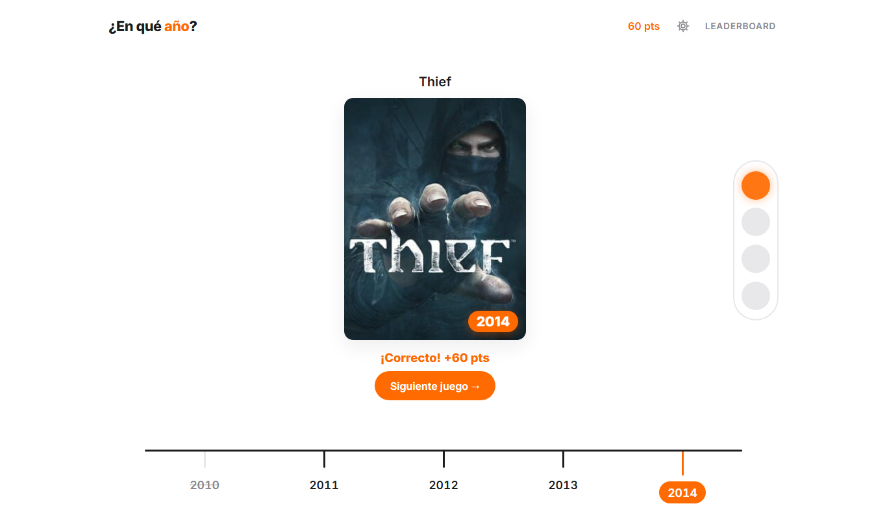
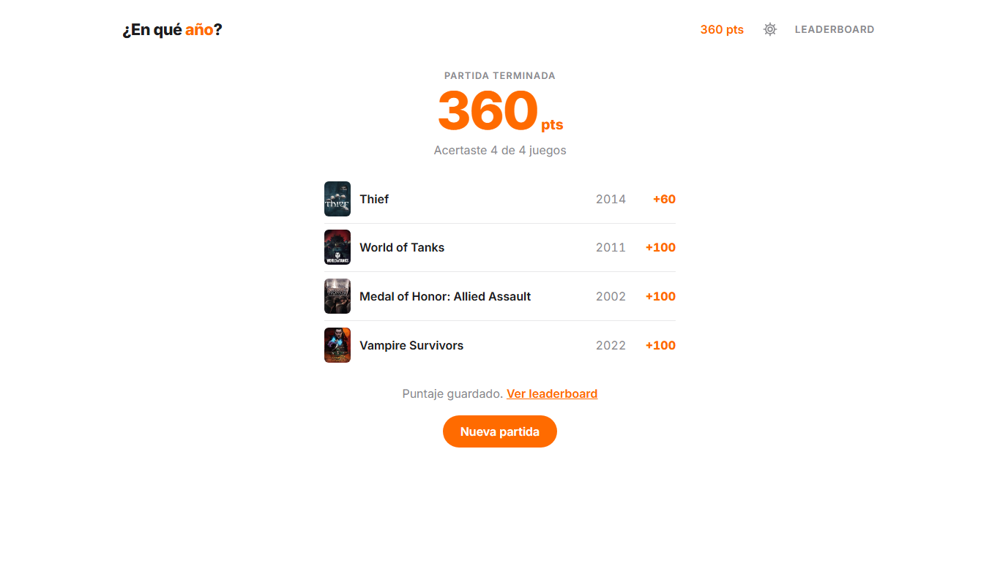

# ¿En qué año? — Trivia de videojuegos

Juego de trivia hecho con **Svelte 5 + SvelteKit**: aparece la tapa y el título de un videojuego y tenés que adivinar **en qué año salió**, eligiéndolo en una línea temporal.



## Cómo se juega

- Cada partida tiene **4 juegos**. El semáforo de la derecha muestra cómo te fue en cada uno: naranja si acertaste, rojo si fallaste.
- Cada juego trae su propia **línea temporal de 5 años** (por ejemplo 2004–2008 o 2019–2023), elegida al azar alrededor del año real.
- Tenés **3 intentos** por juego. Si fallás, el año queda tachado y te avisa si estás cerca (a 1 año) o lejos.
- Puntos por acierto: **100** en el primer intento, **60** en el segundo y **30** en el tercero.
- **Modo Hardcore** (desde el engranaje): un solo intento por juego y los puntos valen el doble.
- Al terminar ingresás tu nombre y el puntaje se guarda en un **Leaderboard online** (Firebase), separado por modo. Se muestran los 4 primeros y, más abajo, tu posición. Cada jugador aparece una sola vez, con su mejor puntaje.



## Datos: entrada y salida

| | De dónde salen | Dónde se guardan |
|---|---|---|
| Juegos, años y tapas | API de [IGDB](https://api-docs.igdb.com/) (vía un endpoint propio en el servidor) | `localStorage`, en caché por 24 h |
| Nombre del jugador y puntaje | Formulario al terminar la partida | [Cloud Firestore](https://firebase.google.com/docs/firestore) (Leaderboard online) |
| Partida en curso y configuración | El propio juego | `localStorage`: si recargás la página, seguís donde estabas |

Si IGDB no responde o no hay credenciales, el juego sigue funcionando con una lista de juegos de respaldo (`src/lib/datos/games.js`).

## Tecnologías

- [Svelte 5](https://svelte.dev/) (runes) y [SvelteKit 3](https://svelte.dev/docs/kit)
- [Vite](https://vite.dev/)
- [IGDB API v4](https://api-docs.igdb.com/) con autenticación de Twitch
- [Firebase / Cloud Firestore](https://firebase.google.com/docs/firestore) para el leaderboard
- CSS propio, sin frameworks (`src/lib/componentes/estilos/`)

## Instalación

Requisitos: [Node.js](https://nodejs.org/) 20 o superior.

```sh
git clone https://github.com/elgonza7/Integrador-Front.git
cd Integrador-Front
npm install
```

### Credenciales de IGDB

1. Entrá a <https://dev.twitch.tv/console/apps> (necesitás una cuenta de Twitch con verificación en dos pasos).
2. **Register Your Application** → OAuth Redirect URL: `http://localhost`, Category: *Application Integration*, Client Type: *Confidential*.
3. Copiá el **Client ID** y generá un **Client Secret**.
4. Copiá `.env.example` como `.env` y completalo:

```sh
IGDB_CLIENT_ID=tu_client_id
IGDB_CLIENT_SECRET=tu_client_secret
```

> El archivo `.env` está en el `.gitignore`: nunca subas tus credenciales al repositorio.

### Ejecutar

```sh
npm run dev       # servidor de desarrollo en http://localhost:5173
npm run check     # chequeo de tipos y de Svelte
npm run build     # versión de producción
npm run preview   # probar la versión de producción
```

## Estructura del proyecto

```
src/
├── env.js                      # declaración de las variables del .env
├── routes/
│   ├── +layout.svelte          # estilos globales, fuente y favicon
│   ├── +page.svelte            # pantalla principal del juego
│   └── api/juegos/+server.js   # endpoint que consulta IGDB
└── lib/
    ├── juego/
    │   ├── juego.svelte.js     # estado y reglas del juego
    │   └── constants.js        # rango de años, intentos, puntos, costo de pistas
    ├── servicios/
    │   ├── api.js              # pide los juegos al endpoint (con caché y respaldo)
    │   └── ranking.js          # leaderboard en Firestore (guardar y leer)
    ├── datos/
    │   ├── games.js            # juegos de respaldo
    │   └── ayudas.js           # pistas por año
    ├── utilidades/
    │   ├── storage.js          # lectura/escritura segura de localStorage
    │   └── tema.svelte.js      # modo claro / oscuro
    ├── server/igdb.js          # token de Twitch + consulta a IGDB (solo servidor)
    └── componentes/
        ├── *.svelte            # Header, JuegoCard, LineaTemporal, Semaforo, Modal...
        ├── base/               # Portada, FilaRanking, Switch (los usan varios componentes)
        └── estilos/            # un .css por componente + base, botones y comunes
```

## Leaderboard en Firestore

Hay dos colecciones, `ranking_normal` y `ranking_hardcore`. Cada documento tiene solo `nombre` y `puntos`, y el id sale del nombre, así cada jugador aparece una vez. Tu posición se calcula contando cuántos tienen más puntos que vos.

Las reglas de seguridad están en [`firestore.rules`](firestore.rules): cualquiera puede leer, y para escribir el nombre tiene que tener entre 1 y 20 caracteres, los puntos tienen que estar dentro del máximo del modo, y solo se puede reemplazar un puntaje por uno mejor.

## Por qué hay un endpoint en el servidor

IGDB no acepta pedidos directos desde el navegador y además pide un *Client Secret* que no puede quedar expuesto en el código del cliente. Por eso el navegador le pide los juegos a `/api/juegos`, y es el servidor de SvelteKit el que habla con Twitch e IGDB:

```
Navegador ──► /api/juegos ──► Twitch (token) ──► IGDB (juegos)
```

Para publicarlo hace falta un hosting con servidor (Vercel, Netlify, etc.) y cargar ahí las dos variables de entorno.

## Autor

Hecho por [@elgonza7](https://github.com/elgonza7) como trabajo integrador de Frontend.
